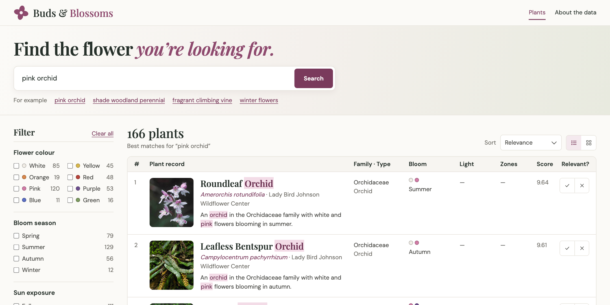

# Buds & Blossoms

A search engine for plants and flowers

Information Retrieval 2026-27 · Project 13: Plants and Flowers

Jana Srbakoska · Salma Abu Husein

Project status: 24 November 2026

## 1. Introduction

Buds & Blossoms collects plant records from several public databases and makes them searchable in one place. Each database uses its own vocabulary, so comparing plants across them is difficult. We map the records onto one schema, index them with BM25 and present them in a web interface with filters.

The system targets gardeners and plant enthusiasts with needs ranging from a specific name ("Katsura tree") to a vague description ("something pink for winter"). Vague needs motivate our complex feature, user relevance feedback: recognising a suitable plant is often easier than describing one.

| Project requirement | Our choice | Status |
|---|---|---|
| At least three websites | Missouri Botanical Garden, NC State, Wildflower Center | Done, 600 records |
| Search, browsing, presentation | BM25 search, A–Z browsing, table and grid | Working |
| Simple feature | Filtering, results in a table, highlighted snippets | Working |
| Complex feature | User relevance feedback (Rocchio) | Buttons only; re-ranking planned |
| Evaluation with three classmates | Feedback off vs. on | Planned |

## 2. Data collection

| Source | How pages are found | Records |
|---|---|---|
| Missouri Botanical Garden Plant Finder | A–Z list pages | 200 |
| NC State Extension Plant Toolbox | sitemap.xml | 200 |
| Lady Bird Johnson Wildflower Center | Search by plant family | 200 |

The suggested Garden.org and our planned fourth source, Gardenia.net, reject automated requests (HTTP 403), so we excluded them. The crawler uses `requests` and BeautifulSoup. It identifies itself with a project user agent, checks robots.txt, waits one second between requests and caches every page, so that parsing can be repeated without downloading again. If robots.txt cannot be fetched, the crawler currently assumes access is allowed; a stricter policy would be safer.

A record is kept only if it has flower colour information and a photo. Duplicates are removed by scientific name within each source, but not across sources.

## 3. Schema and normalisation

Each record has a name, scientific name, source, URL, photo, family, plant type, description, additional text, colours, bloom seasons, sun exposure, and minimum and maximum USDA hardiness zones.

| Attribute | Normalisation | Example |
|---|---|---|
| Colour | Whole-word matching of colour names and variants to 8 colours | "Purplish blue" → Purple, Blue |
| Season | Months, seasons and ranges, wrapping around the year | "Late Fall to May" → Autumn, Winter, Spring |
| Sun | Phrase rules to 3 levels | "Dappled sunlight" → Partial shade |
| Type | Ordered keyword rules; Orchidaceae is always Orchid | "Broadleaf evergreen" → Shrub |
| Zone | Lowest and highest zone number found | "5a, 6b" → 5–6 |

If a page gives no colour, the normaliser searches the start of the additional text. If it gives no prose, the normaliser builds a short description from structured fields. This affects 88 Wildflower Center records. Their snippets are therefore our text, not the source's.

### The collection

The 600 records cover 96 plant families and 589 distinct scientific names, 11 of which occur in more than one source. A plant can have several colours, seasons and sun levels, so these counts exceed 600.

| Attribute | Records per value |
|---|---|
| Type | Herbaceous perennial 258, Shrub 127, Tree 73, Annual 59, Bulb 25, Orchid 21, Vine 16, Grass 15, Other 4, Succulent 2 |
| Colour | White 243, Yellow 233, Purple 167, Pink 120, Red 107, Green 94, Blue 75, Orange 61 |
| Season | Summer 401, Spring 351, Autumn 159, Winter 42 |
| Sun | Full sun 391, Partial shade 350, Full shade 73 |
| Missing | Zone 216 (including all 200 Wildflower Center records), sun 96, season 27 |

## 4. Architecture

Crawler → normaliser → JSON Lines file → in-memory BM25 index → FastAPI service → React interface

- **Crawler and normaliser** (`crawler/`): download, parse and normalise pages offline.
- **Index** (`indexer/`): loads the collection at start-up; handles ranking, filters, facet counts and snippets.
- **Backend** (`backend/`): offers `/api/search` and `/api/stats`.
- **Frontend** (`frontend/`): React and Vite application calling the API.

JSON Lines is sufficient for 600 records and easy to inspect. We implemented the pipeline ourselves rather than using Solr, so that the ranking can be extended with our own Rocchio implementation.

## 5. Indexing and retrieval

**Text processing.** Text is lower-cased and split into alphanumeric tokens. Stop words are removed, and a light plural stemmer in the style of Harman's S-stemmer is applied. It does not conflate "climbing" and "climber".

**Document representation.** Fields are weighted by repetition: common name three times, scientific name twice, normalised attributes and family three times, descriptions once. This is simple, but it also lengthens documents and interacts with BM25's term-frequency saturation; per-field weights would be cleaner.

**Query processing.** Words that occur in most records ("flower", "flowering", "bloom", "blooming", "plant") are dropped if more specific words remain. "Fall" and "autumn" are expanded to both terms, because our season label is Autumn while descriptions often say "fall".

**Ranking.** We use BM25 from `rank_bm25` with its default parameters. The library scores all documents for every query; an inverted index of our own is planned. A record is returned if its score is positive, so matching any query word is enough. Results can also be sorted by name or hardiness zone.

| Query | Results | Top results |
|---|---|---|
| pink orchid | 166 | Roundleaf Orchid, Leafless Bentspur Orchid, Rosebud Orchid |
| winter flowers | 237 (572 before query processing) | Winter's Rose Camellia, Koaoha, California Suncup |
| fall flowers | 320 (564 before) | Autumn Spirit Camellia, Cranesbill, Fall Poison |
| fragrant climbing vine | 99 | Arizona Honeysuckle, Balloonvine, Broadleafed Birthwort |
| shade woodland perennial | 508 | Green and Gold, Baneberry, Appalachian False Goatsbeard |
| lavendar (misspelled) | 0 | – |

These are examples of behaviour, not a measurement of effectiveness. They show reasonable first results but very broad result sets, and no tolerance of misspellings. "Fall Poison" shows that words in names can outweigh the intended meaning. Negation is not supported: "not pink" still ranks pink plants.

## 6. Interface

- **Search and browsing:** an empty search lists all plants A–Z; example queries help users start.
- **Table:** photo, names, source, snippet, family, type, bloom, light, zones, score and feedback buttons. A grid view offers visual browsing.
- **Filters:** colour, season, sun, zone, type and source. Values within an attribute are combined with OR, and attributes with AND. Counts for an attribute apply all *other* filters, so users see what each choice would add. The zone filter has no counts.
- **Snippets:** the sentence with the most distinct query terms, with following text up to about 230 characters and matching words highlighted.
- **Links:** every name links to its source page.

Records with missing data disappear when the corresponding filter is used; for zones this removes the whole Wildflower Center. All results are returned at once, without pagination.

## 7. Relevance feedback (planned)

The table has ✓ and ✗ buttons, but they only change interface state and do not yet affect results. We plan to:

1. represent records and queries as weighted term vectors on our own inverted index, since Rocchio is defined for vectors and `rank_bm25` does not accept query-term weights;
2. compute **q′ = α q + (β / |R|) Σ d** over the records R marked ✓, keeping only the strongest expansion terms and a high weight for the original query;
3. remove records marked ✗ rather than subtracting their vectors, since negative examples are rarely used in practice and can distort the query;
4. return updated results, show the added terms and let users reset, and add the buttons to the grid view.

Starting values are α = 8 and β = 16 (γ is not used), to be adjusted during the pilot.

## 8. User evaluation (planned)

No evaluation has been run yet. Three classmates will compare the system with feedback **off** (baseline) and **on** (experimental); nothing else changes.

**Hypothesis.** With feedback on, participants need fewer queries to find five plants they consider suitable.

**Tasks.** Different but comparable tasks per condition: a decision task ("choose three plants for a shady woodland bed"), a background task ("explore winter-flowering plants") and a fact task ("in which zones does a given plant grow?").

**Procedure.** Consent and introduction, a short practice search, tasks in both conditions, then questionnaire and interview. Task and system order are rotated as evenly as three participants allow. A pilot comes first.

**Measures.** Time, number of queries, suitable plants found, feedback clicks, SUS and comments. Logging still has to be added. With three participants we will report results descriptively and make no claims of statistical significance.

## 9. Limitations

- **Sampling.** By scientific name, NC State covers A–C and Missouri A–K, and 95 of 200 Wildflower Center records start with A. The crawler stops at 200 records before reaching later pages. Interleaving letters and families would correct this.
- **Missing and generated data.** Zones, sun and some seasons are incomplete, and 88 descriptions are generated.
- **Retrieval.** Any-word matching, plural-only stemming, no spelling support, no phrase or negation handling.
- **Normalisation.** Keyword rules are brittle, and individual records have not been checked systematically against their pages.
- **Scale.** Scoring every record and returning all results is acceptable only for a small collection.

## 10. Division of work

- **Jana:** [fill in]
- **Salma:** [fill in]

## 11. Next steps

| When | Work |
|---|---|
| 25 Nov–1 Dec | Inverted index and Rocchio; wider sample; filter improvements; logging |
| 2 Dec | Pilot test |
| 3–6 Dec | Evaluation with three classmates |
| 9–13 Dec | Analysis and final report |
| 14–15 Dec | Presentation; report and code submission |

## 12. Conclusion

The path from crawling to a usable search interface is complete: 600 records from three sources share one schema and can be searched, browsed and filtered. The main outstanding work is making relevance feedback change the results and evaluating it with users. A more even sample and more precise ranking would improve the system most beyond that.
