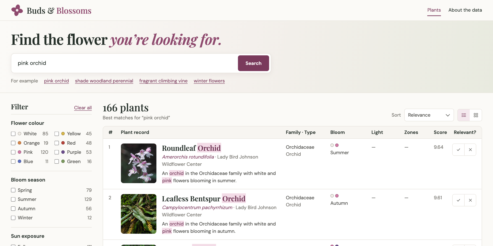

# Buds & Blossoms: Progress Report
Information Retrieval 2026-27, Project 13: Plants and Flowers · Jana Srbakoska, Salma Abu Husein · 24 November 2026

## Goal and collection
Users with specific or vague needs ("something pink for winter") can search, filter and browse plants. We crawled **600 records**, 200 each from the Missouri Botanical Garden Plant Finder (A–Z lists), NC State Extension Plant Toolbox (sitemap) and Lady Bird Johnson Wildflower Center (family search). Garden.org and Gardenia.net reject automated requests (HTTP 403). The crawler checks robots.txt, waits 1 s between requests and caches pages. A normaliser maps the sites' vocabularies to one schema, e.g. "Dappled sunlight" → Partial shade.

## Current implementation
| IR process | What we have built |
|---|---|
| Acquisition, transformation | Crawler, site-specific parsers and a normaliser produce one JSON Lines collection |
| Indexing | Lower-casing, stop-word removal, plural stemming; bag of words with names and attributes boosted by repetition |
| Query processing | Same text processing; generic words ("flower", "plant") dropped when others remain; fall/autumn expansion |
| Retrieval | BM25 ranking (`rank_bm25`, k = 1.5, b = 0.75) combined with Boolean filters |
| Presentation (simple features) | Table and grid, six filters, sorting, highlighted query-based snippets |
| Relevance feedback (complex feature) | ✓/✗ buttons in the table; they do not change the ranking yet |

Architecture: requests/BeautifulSoup → JSON Lines → in-memory BM25 index → FastAPI → React.

## What we observe
- **Ranking:** for "pink orchid", Roundleaf Orchid scores 9.64: "orchid" (in 23 records) contributes 7.41 and "pink" (159) 2.23, mainly because of IDF.
- **IDF:** `rank_bm25` replaces negative IDFs with a fixed floor, so "flower" (557 records) gets 1.28 but "pink" 1.02. Dropping generic words works around this ("winter flowers": 572 → 237 results).
- **Matching:** any query word is enough: "pink orchid" returns 166 records, of which 16 contain both words. "Climbing" and "climber" do not match each other, and misspellings find nothing.
- **Collection:** sampling is uneven (by scientific name, NC State A–C, Missouri A–K, 95 Wildflower Center records under A). 216 records lack zones and 96 light data. 88 descriptions, including those shown above, are generated from structured fields.

## How we will improve and expand
- **Relevance feedback:** Rocchio re-ranking; ✓-marked plants modify the query, ✗-marked plants are removed from the results.
- **Search:** our own inverted index, an IDF that penalises common words, and preference for records matching more query words; compare stronger stemmers.
- **Collection:** more records, sampled evenly; merge plants found in several sources; label generated descriptions.
- **Interface:** pagination, feedback buttons in the grid, and notice of records hidden by missing data.