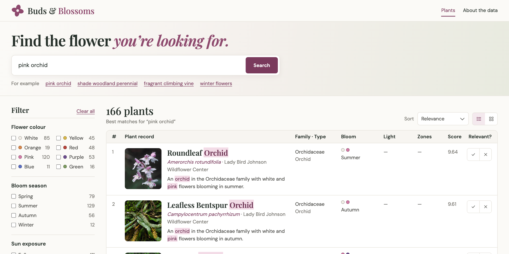

# Buds & Blossoms: Progress Report
Information Retrieval 2026-27, Project 13: Plants and Flowers · Jana Srbakoska, Salma Abu Husein · 24 November 2026

## Sources and document counts
| Source | How pages are found | Records |
|---|---|---|
| Missouri Botanical Garden Plant Finder | A–Z list pages | 200 |
| NC State Extension Plant Toolbox | sitemap.xml | 200 |
| Lady Bird Johnson Wildflower Center | search by plant family | 200 |

The suggested Garden.org and our planned fourth source, Gardenia.net, reject automated requests (HTTP 403). The crawler checks robots.txt, waits 1 s between requests and caches pages. We keep plants with flower colour information and a photo, de-duplicated within each source.

## Schema
A normaliser maps each site's vocabulary (e.g. "Dappled sunlight" → "Partial shade") onto one schema: name, scientific name, family, type, description, photo, colours, seasons, sun, hardiness zones, source, URL.

## Chosen features
| Feature | Type | Status |
|---|---|---|
| Results in a table | simple | working |
| Filtering (colour, season, sun, zone, type, source) | simple | first version working |
| User relevance feedback (Rocchio) | complex | ✓/✗ buttons only; re-ranking next |
| Highlighted result snippets | simple (stretch) | early version working |

Gardening queries are often vague ("something pink"), so letting users mark plants they like is a natural way to refine results.

## Architecture and current state
Crawler (requests, BeautifulSoup) → normaliser → JSON Lines → BM25 index with field boosting → FastAPI → React UI.
Working: crawling and normalisation, BM25 search with stop-word removal, light stemming and fall/autumn synonyms, sorting, filters, and table and grid views.

## Known limitations
Records are unevenly sampled: by scientific name, NC State covers only A–C and Missouri A–K, and 95 of the 200 Wildflower Center records start with A. 216 records have no hardiness zone, including all from the Wildflower Center, and 96 have no light data. For 88 Wildflower Center records without prose, our normaliser builds the description from structured fields (as in the two rows shown above). Any matching query word returns a record, so results are broad. Eleven scientific names occur in more than one source.

## Division of work so far
- **Jana:** [fill in]
- **Salma:** [fill in]

## Next steps
- **25 Nov–1 Dec:** our own inverted index and Rocchio re-ranking; ✗-marked plants are removed, as negative examples will not enter the query vector (Jana). Wider sample, filters and facet UI (Salma).
- **2 Dec:** pilot test. **3–6 Dec:** evaluation with three classmates, feedback off vs. on (rotated task and system order; time, number of queries, relevant plants found, SUS).
- **9–15 Dec:** analysis, presentation, final report and code submission.
